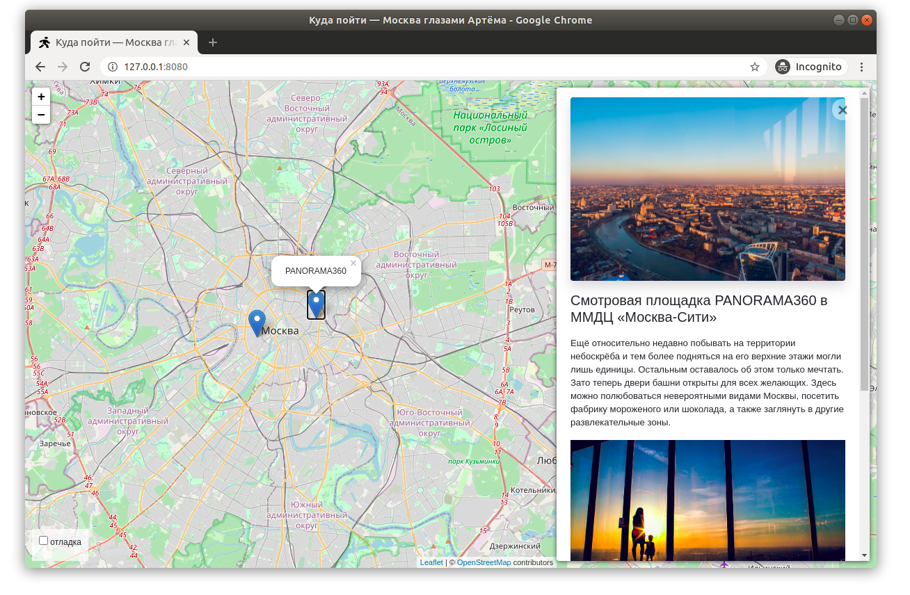

# Куда пойти — Москва глазами Артёма

Сайт с картой интересных мест Москвы. На карте отмечены места, по клику открывается карточка с фотографиями, коротким и подробным описанием. 



## Как установить

Python3 должен быть уже установлен.

Создайте и активируйте виртуальное окружение.

Windows(PowerShell):
```
python -m venv venv
venv\Scripts\activate
```

Затем используйте `pip` (или `pip3`, есть конфликт с Python2) для установки зависимостей:
```
pip install -r requirements.txt
```

Настройки и ключи хранятся в файле `.env` в корне проекта. Скопируйте пример:
```
copy .env.example .env
```

Впишите в `.env` свои значения:

- `SECRET_KEY` — секретный ключ Django, обязательная переменная.

- `DEBUG` — режим отладки. `True` только для разработки, без переменной будет `False`.

- `ALLOWED_HOSTS` — адреса сайта через запятую, например `127.0.0.1,localhost`.

Создайте базу данных и администратора:
```
python manage.py migrate
python manage.py createsuperuser
```

## Как Запустить проекта

Запустите сервер:
```
python manage.py runserver
```

- Сайт: http://127.0.0.1:8000/
- Админка: http://127.0.0.1:8000/admin/

## Цель проекта

Код написан в образовательных целях...